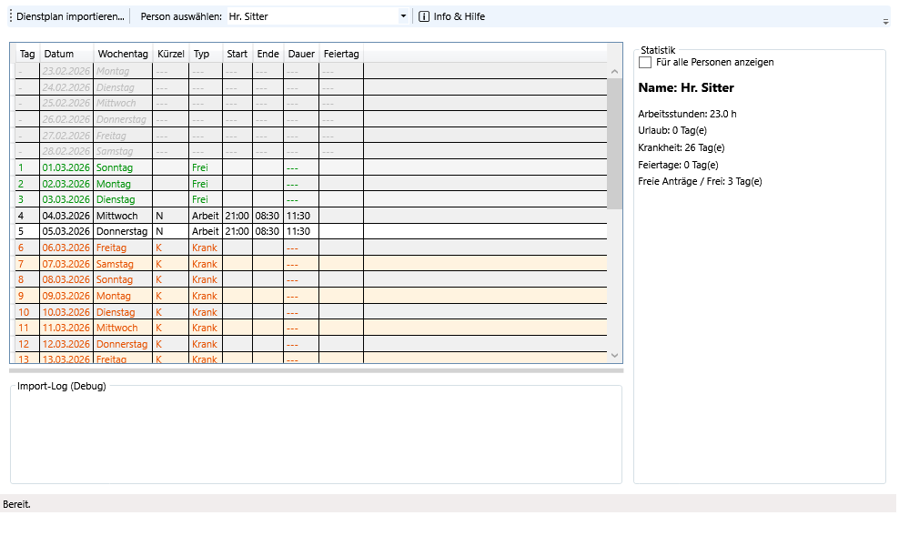

<div align="center">
  
  <h1>Dienstplaner</h1>
  <p><b>Intelligenter Dokumentenleser & Schicht-Statistik für Word-Dienstpläne</b></p>
</div>



## Über das Projekt
Der **Dienstplaner** ist eine Desktop-Anwendung (.NET 8 WPF), die automatisiert Word-Dienstpläne (`.doc` und `.docx`) von Krankenhäusern, Stationen oder Pflegediensten einliest und analysiert. Sie entschlüsselt die kryptischen Schicht-Kürzel und erstellt sofort saubere Monatsstatistiken, berechnet Arbeitsstunden und listet Krankheitstage auf.

## Features
- **Intelligenter Import:** Liest nahtlos Word-Tabellen via _FreeSpire.Doc_ und _OpenXml_ aus.
- **Auto-Kalkulation:** Erkennt automatisch Kürzel wie `T`, `N`, `K`, `U`, etc. und rechnet sie in exakte Stunden (TimeSpan) um.
- **Einzel- & Gesamtansicht:** Wähle einzelne Personen aus oder betrachte zusammengefasste Monatsstatistiken für das komplette Team.
- **Integrierte Dokumentation:** Eingebautes Hilfe-Fenster (Info & Hilfe) liefert jederzeit Transparenz über die internen Berechnungen.
- **Autarke `.exe` (1-Klick Setup):** Komplett offline lauffähig, ohne Installation.

## Download & Start
Lade dir die neueste, sofort ausführbare `Dienstplanner.exe` unter den [GitHub Releases](../../releases) herunter.
Das Tool benötigt keine Administratorrechte oder zwingende Vorinstallationen, da alle .NET 8 Abhängigkeiten bereits eingebaut sind (Single-File App).

## Entwicklung (Entwickler)
Das Projekt nutzt **C# / .NET 8 / WPF / MVVM**.
```bash
# Projekt klonen
git clone https://github.com/K0pfnicker/Dienstplanner.git

# Lokalen Build testen
cd Dienstplanner
dotnet run --project src/Dienstplanner/Dienstplanner.csproj
```

## Architektur
- **MVVM Pattern:** Trennt die UI sauber von der Logik (`ViewModels` vs `Views`).
- **Domain Services:** Der `ShiftCodeInterpreter` kümmert sich um die Business-Logic und die Dienst-Auflösungen.
- **CI/CD:** Automatische Release-Builds (`.exe`) via GitHub Actions.
